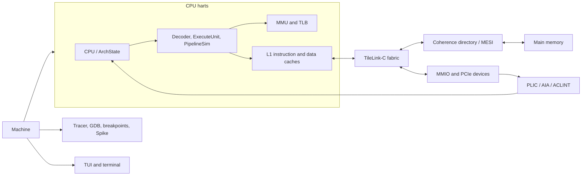
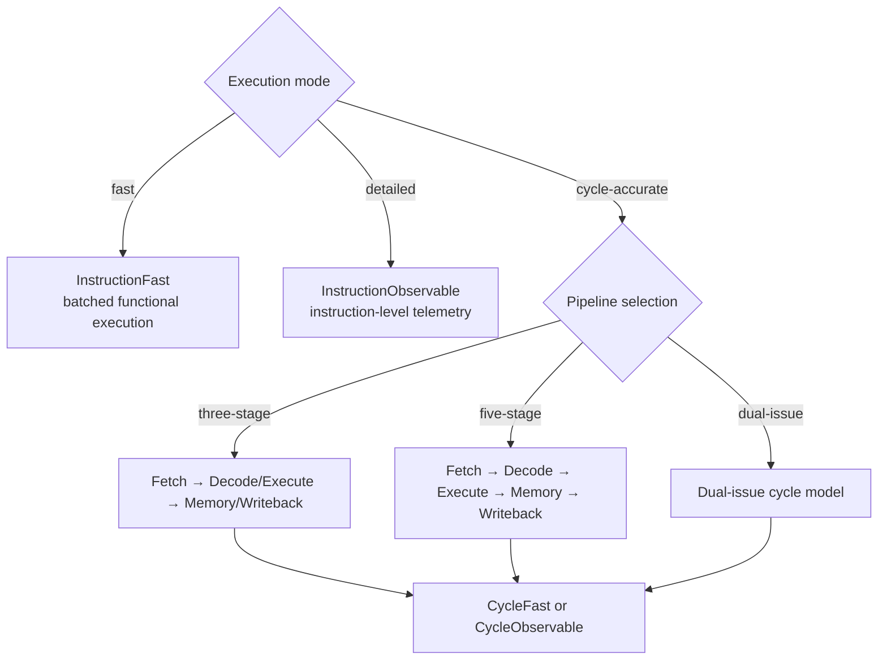

# SimRV Architecture

SimRV is a C++23 RISC-V simulator for RV32 and RV64 targets. It runs baremetal
images and full Linux OS configurations through fast functional instruction execution,
detailed state simulation, or cycle-accurate microarchitectural modeling. ISA qualification
claims and known gaps are maintained in [RISC-V compliance scope](compliance.md).

## Runtime Structure

`Machine` orchestrates the virtual platform: CPU harts, memory subsystem, TileLink-C
interconnect, PCIe root complex, platform interrupt controllers, and device endpoints.
The diagram shows how those main parts relate at runtime.



The `CPU` hart owns architectural state, translation structures, caches, branch prediction,
and execution policy. The platform registry connects MMIO devices and interrupt controllers to
the machine; tracing and presentation observe machine state without changing guest-visible
architectural behavior.

## Execution Policies & Microarchitectures

Execution is configured via `--mode <name>` and resolved into runtime profiles:



The `CycleFast` and `CycleObservable` policies share the selected pipeline timing model; observable
execution retains telemetry for inspection. Fast instruction mode instead uses decode caching and
quantum batching where the active debug and tracing features allow it.

In cycle-accurate and pipeline modes, instruction slots traverse stages with explicit data forwarding,
structural hazard stalls, and branch-prediction redirection. Architectural effects commit strictly
at the retirement boundary.

### Counters, clocks, and virtual time

The virtual platform models a nominal CPU clock (default: 160 MHz) and an architectural timer timebase (default: 10 MHz), configurable via `--cpu-clock` and `--timebase-hz`.
Timing progression is governed by `DeterministicClockDivider` in `PlatformTiming.hpp`; by default, `mtime` advances once per
16 modeled CPU cycles (100 ns per tick). Exact integer dividers eliminate fractional drift, while arbitrary frequency pairings
use a 64-bit phase accumulator to guarantee cycle-exact timer progression across multi-billion-cycle runs.

Counter interpretation depends on the execution policy:

- In cycle-accurate mode, `mcycle`/`cycle` advances for every modeled clock cycle, including stalls,
  bubbles, cache/interconnect waits, and recovery cycles. Cycle-based device and memory delays can
  therefore be converted to virtual seconds using the active CPU clock frequency.
- In fast and detailed instruction-accurate modes, one execution step is assigned one virtual CPU
  cycle. `mcycle` and `mtime` remain deterministic and useful to guest software, but elapsed virtual
  time is not a prediction of physical hardware time or workload latency.
- In every mode, `minstret`/`instret` counts successfully retired instructions. Instructions that
  trap before retirement do not increment it.

The TUI labels the instruction-accurate value as `virt` and the cycle-accurate value as `sim` to
make this distinction explicit. Host elapsed time and execution speed are separate measurements.

!!! info "Interpreting virtual time"
    Treat cycle counts as a hardware timing model only in cycle-accurate mode, and only when the
    configured pipeline and device latencies are calibrated to a reference implementation. Fast
    and detailed modes keep guest timers deterministic; they do not estimate real execution time.

### Fast-Batch Execution Engine & Debug Fallbacks

In `--mode fast` (Instruction-Accurate), single-hart OS kernels and baremetal applications run via the
`run_fast_os_batch` / `run_fast_baremetal_batch` acceleration engines:

- **Batched Retirement & Telemetry**: Eliminates per-instruction atomic operations on machine-wide retirement
  counters, synchronizing only at chunk, decode miss, or batch boundaries.
- **CLINT Chunking**: Virtual counters (`mcycle`, `mtime`, and timer interrupt evaluations) update in
  64-instruction chunks during tight loops, preventing timer evaluation overhead on every single instruction.
- **Inlined Cached Helpers**: Load, store, branch, and jump operations inline directly into the opcode dispatcher
  without function call frames.
- **Automatic Debug Fallback**: Fast batching is governed by `Machine::fast_batch_policy()`. The moment any
  breakpoint or watchpoint is registered (`breakpoints.has_any()`), lockstep testing is engaged, instruction tracing
  is active, or the user is single-stepping (`is_stepping()` or `step_delay_us != 0`), fast-batching immediately
  disengages. Execution automatically reverts to the cycle-by-cycle engine (`CPU::run_cycle`), guaranteeing
  100% single-instruction hit precision, accurate watchpoint diffing, and fine-grained TUI animation.

## Multi-Hart SMP & TileLink-C Coherence

Multi-hart configurations (`--smp <N>`, `N` from 1 through 16) simulate symmetric multiprocessing:

1. **Directory Coherence**: L1 caches participate in directory-based cache coherence implementing the MESI (Modified, Exclusive, Shared, Invalid) protocol over TileLink-C channels.
2. **Interrupt Routing**: Core local interrupts (software/timer) are managed via CLINT or ACLINT (MTIME/MSWI). External platform interrupts are handled by PLIC or AIA (APLIC wire interrupts and IMSIC message-signaled interrupts).
3. **Synchronization**: Atomic operations (LR/SC and AMOs) use a global reservation table and coherent bus transactions across harts.

`--steps` / `-e` applies to the machine-wide retired-instruction total, not just hart 0. In
deterministic instruction mode, harts advance in round-robin order within each scheduler quantum;
MT-SMP may retire a small number of additional instructions while workers observe the stop request.

## Debugger ownership and synchronization

The TUI and GDB are mutually exclusive frontends over machine-owned debug primitives. TUI debug
actions are always available; GDB runs its blocking TCP accept/read loop on one `std::jthread` and
passes parsed requests through a synchronized command/reply channel. Machine-facing debugger
requests inspect or mutate architectural state, devices, execution state, and logical
break/watchpoints only on the simulation thread after quiescing execution workers.
Packet handlers return an explicit optional reply and connection disposition; only the transport
worker frames and sends replies, including asynchronous stops while awaiting packet bytes.

GDB uses all-stop semantics. Attach and startup hold all harts paused, stop events quiesce SMP
workers, and a selected-hart single-step runs the normal execution model until that hart retires
one instruction. An atomic control-event generation counter wakes paused simulation and dormant SMP
workers without periodic sleeps. Fast IA execution observes control requests at bounded 256-
instruction safe points; detailed and CA execution observe them every retirement or cycle.
Bare-metal and OS runners share worker lifecycle coordination but retain their execution kernels.
Step requests use a release/acquire handoff. Completion is acknowledged after worker quiescence and
snapshot publication; synchronous callers use a predicate-based condition-variable wait with a real
deadline. Parallel harts evaluate their own timer interrupt state instead of hart 0 mutating it.

Breakpoint records have stable IDs and frontend ownership. Debugger disconnect removes only GDB-owned
logical breakpoints and watchpoints without rewriting guest instructions or disturbing TUI state.
Detaching resumes guest execution and retains the listener socket; an unexpected client disconnect
cleans GDB-owned state, leaves the target paused, and re-listens for new connections.

## CA timing and ordering

In `cycle-accurate` mode, CA uses deterministic global cycles. On each cycle SimRV:

1. Advances hart 0, then started secondary harts in ascending order.
2. Advances the shared TileLink/coherence fabric once.
3. Updates shared timer and interrupt-pending state.
4. Performs termination and presentation work outside the architectural step.

The SMP synchronization quantum batches complete global cycles before host-side UART and TUI
presentation work. It does not give one hart a longer modeled time slice: all started harts still
advance exactly once per global cycle. Debugging, tracing, breakpoints, delayed execution, and
single-step reduce the batch to one cycle.

In `multi-threaded` SMP mode (configured via SoC profile), harts execute each global cycle on separate
worker threads and synchronize at the cycle boundary before the shared fabric and timers advance.
Requests from that cycle are ordered by logical cycle, hart ID, and per-hart issue order. Interrupt
lines and hart lifecycle changes are applied at hart boundaries. The synchronization quantum groups
complete global cycles into one host-side runner turn; cycle ordering remains synchronized within
the batch. Pause, reboot, reconfiguration, shutdown, and single-step first quiesce the workers.

!!! warning "Use deterministic single-threaded for cycle parity"
    Use `single-threaded` (lockstep) mode for cycle traces and cycle-by-cycle RTL comparisons.
    `multi-threaded` mode keeps global cycle counts and shared-request ordering deterministic while
    executing hart work in parallel; synchronization overhead can outweigh the parallel work on short workloads.

The CPU model controls pipeline, cache, and interconnect timing. Cache hit/miss
latencies and TileLink request/response latencies are positive whole-cycle
values. A transport latency of one is the default baseline: a request completes
on the next bus step and its response is visible in that completion cycle.
Squashed fetch and data requests are cancelled by hart/port source identity.

CA page walks are resumable transactions. PTE reads and accessed/dirty updates
share the bus ordering model; A/D updates use an atomic OR. This preserves a
single translation behavior while allowing CA to expose latency.

## Source layout

```text
include/simrv/  Interfaces and inline implementation
src/            Implementation units mirroring include/
tests/          Native semantic, pipeline, UI, platform, and CLI tests
scripts/        Build, benchmark, release, and reproduction helpers
docs/           User, contributor, compliance, and release documentation
```

Useful entry points are `src/Main.cpp`, `src/core/Machine.cpp`,
`src/core/Cpu.cpp`, and `src/pipeline/CycleKernel.cpp`. See
[TUI architecture](../user/tui.md), [bare-metal development](../user/baremetal.md),
[Linux image building](../user/linux.md), and
[extension development](../hardware/extensions.md) for focused workflows.

## Build and validation

Use the `rv32-release` or `rv64-release` CMake preset. The focused native gate
is `ctest --test-dir build/rv64-release --output-on-failure -L gate`; some gate
tests require external images or tools. Record CA performance with
`scripts/benchmark.sh --ca`. Compare reports only on equivalent hosts, compilers,
guest binaries, and instruction limits. On Linux laptops, set
`SIMRV_CA_BENCH_AFFINITY=<cpu>` to pin the benchmark and reduce scheduling and
thermal-frequency noise; allow a cooldown between long comparison runs.

## Local performance reference host

The current development measurements are recorded on an Intel Core Ultra X7 358H
(16 logical CPUs, 48 MiB L2, 18 MiB L3), with 31.1 GiB available memory, under
Linux 6.18.33.2-microsoft-standard-WSL2. Benchmarks pin to logical CPU 0. WSL2
does not expose the host governor or frequency telemetry here, so these results
are local regression evidence only—not portable performance claims. Use the
`rv64-native-release` Clang preset for local tuning; release artifacts continue to
use the portable `rv64-release` x86-64-v3 configuration.
