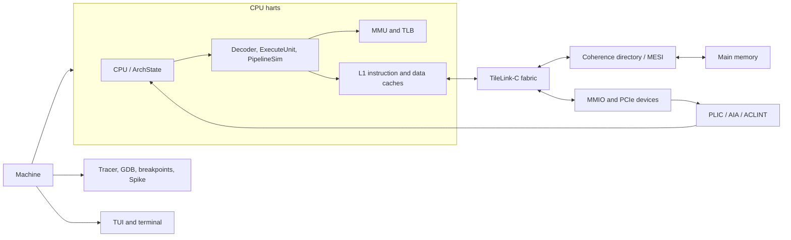
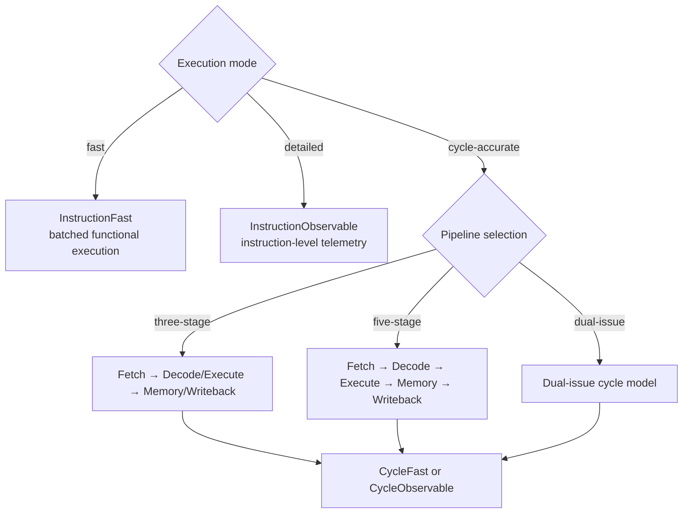

# SimRV Architecture

SimRV is a C++23 RISC-V simulator for RV32 and RV64 targets. It runs baremetal
images and full Linux OS configurations through fast functional instruction execution,
detailed state simulation, or cycle-accurate microarchitectural modeling. ISA qualification
claims and known gaps are maintained in [RISC-V compliance scope](compliance.md).

## Runtime Structure

`Machine` orchestrates the virtual platform: CPU harts, memory subsystem, TileLink-C
interconnect, PCIe root complex, platform interrupt controllers, and device endpoints.
The diagram shows how those main parts relate at runtime.



The `CPU` hart owns architectural state, translation structures, caches, branch prediction,
and execution policy. The platform registry connects MMIO devices and interrupt controllers to
the machine; tracing and presentation observe machine state without changing guest-visible
architectural behavior.

## Execution Policies & Microarchitectures

Execution is configured via `--mode <name>` and resolved into runtime profiles:



The `CycleFast` and `CycleObservable` policies share the selected pipeline timing model; observable
execution retains telemetry for inspection. Fast instruction mode instead uses decode caching and
quantum batching where the active debug and tracing features allow it.

In cycle-accurate and pipeline modes, instruction slots traverse stages with explicit data forwarding,
structural hazard stalls, and branch-prediction redirection. Architectural effects commit strictly
at the retirement boundary.

### Counters, clocks, and virtual time

The virtual platform models a nominal CPU clock (default: 160 MHz) and an architectural timer timebase (default: 10 MHz), configurable via `--cpu-clock` and `--timebase-hz`.
Timing progression is governed by `DeterministicClockDivider` in `PlatformTiming.hpp`; by default, `mtime` advances once per
16 modeled CPU cycles (100 ns per tick). Exact integer dividers eliminate fractional drift, while arbitrary frequency pairings
use a 64-bit phase accumulator to guarantee cycle-exact timer progression across multi-billion-cycle runs.

Counter interpretation depends on the execution policy:

- In cycle-accurate mode, `mcycle`/`cycle` advances for every modeled clock cycle, including stalls,
  bubbles, cache/interconnect waits, and recovery cycles. Cycle-based device and memory delays can
  therefore be converted to virtual seconds using the active CPU clock frequency.
- In fast and detailed instruction-accurate modes, one execution step is assigned one virtual CPU
  cycle. `mcycle` and `mtime` remain deterministic and useful to guest software, but elapsed virtual
  time is not a prediction of physical hardware time or workload latency.
- In every mode, `minstret`/`instret` counts successfully retired instructions. Instructions that
  trap before retirement do not increment it.

The TUI labels the instruction-accurate value as `virt` and the cycle-accurate value as `sim` to
make this distinction explicit. Host elapsed time and execution speed are separate measurements.

!!! info "Interpreting virtual time"
    Treat cycle counts as a hardware timing model only in cycle-accurate mode, and only when the
    configured pipeline and device latencies are calibrated to a reference implementation. Fast
    and detailed modes keep guest timers deterministic; they do not estimate real execution time.

### Fast-Batch Execution Engine & Debug Fallbacks

In `--mode fast` (Instruction-Accurate), single-hart OS kernels and baremetal applications run via the
`run_fast_os_batch` / `run_fast_baremetal_batch` acceleration engines:

- **Batched Retirement & Telemetry**: Eliminates per-instruction atomic operations on machine-wide retirement
  counters, synchronizing only at chunk, decode miss, or batch boundaries.
- **Clock Accounting**: The OS engine flushes virtual clock and retirement accounting at bounded
  chunk and fallback boundaries; the bare-metal engine accounts cached cycles at its batch boundary.
- **Inlined Cached Helpers**: Load, store, branch, and jump operations inline directly into the opcode dispatcher
  without function call frames.
- **Batch Eligibility**: `Machine::fast_batch_policy()` declines batching for SMP, stepping,
  lockstep, branch tracing, breakpoints or watchpoints, architectural triggers, and an active TUI
  trace or step delay, and the CFU console redirect model.
  The scheduler otherwise services controls and publishes batch-level state at its boundaries.

Fast shortcuts must preserve the effects of their general paths. Cached execution must stop or
fall back at control, trap, and observation boundaries. Direct RAM access requires a valid range
and the applicable translation and protection checks; stores must preserve `tohost`, triggers,
and reservation effects. Vector bulk access falls back when an element needs individual checks.
Fetch shortcuts still check execute permission before decoding. Cache MRU lookup verifies the tag,
valid bit, and coherence state before returning a line. Typed device accesses retain their device
and bus side effects. MMIO routing checks device ownership even for MRU hits and rejects a transfer
if any addressed byte falls outside the selected device. Device registration and range queries
scan ambiguous sparse overlaps up to 4096 bytes and conservatively report larger ambiguous overlaps
as occupied. The decode cache uses 64-byte-aligned sets; this is a layout choice, not a claim that
every supported host has a 64-byte cache line.

Checked RAM lookups reject addresses below the mapping and accesses that wrap the physical address
space. The unchecked fast lookup is used only with non-null, nonwrapping RAM and an access size no
larger than the mapping; other configurations take the checked fallback.

#### Audit evidence and remaining coverage

The following findings describe guest correctness, rather than security severity:

| Finding | Severity | Evidence and resolution |
| --- | --- | --- |
| A reservation invalidation range could truncate on native RV32. | High | The reservation table now accepts a host-sized length and saturates at the physical address limit. `CoreSemanticsTests` covers ranges exceeding the guest address width. |
| A wrapping RAM mapping could make an unchecked host pointer lookup invalid. | High | Fast lookup now requires a nonwrapping mapping; checked lookups reject wrapped accesses. `CoreSemanticsTests` covers the boundary. |
| Cycle-mode workers could fail to acknowledge an in-flight cycle during a pause or engine change. | High | Workers complete the cycle barrier before parking, and engine changes restart workers. The multi-hart regression tests exercise pause and switching. |
| The RVComp guest uses a serial register layout different from the built-in UART, producing spurious NUL output. | Medium | The model selects an external UART plugin with the expected status registers; `RvCompTests` exercises transmit, receive, and interrupt behavior. The plugin transmits immediately and is not a cycle-accurate UART model. |

These checks document reviewed paths, not a proof that every first-party shortcut has been
inventoried. In particular, full architecture-suite and performance comparisons against the
original starting tree remain incomplete; ARM hardware and usable host performance counters were
unavailable. See [strong typing and performance](../development/strong-typing-performance.md)
for the measurements and their limitations.

MMIO routing and DMA APIs accept `simrv::xlen::PhysAddr`. C++ callers must explicitly construct
physical addresses from platform configuration or translate virtual addresses before routing or
DMA. Loaded segment records used for cache prewarming also require `PhysAddr`.
PMP access checks require `PhysAddr`; callers must translate virtual addresses before protection
checks, including page-table accesses.
`TileLinkNode::base_address()` returns `PhysAddr`, and `contains()` takes `PhysAddr`; C++ device
implementations must update their overrides. An override of `contains()` should also declare
`using TileLinkNode::contains;` so the base class's deleted raw-integer overload stays visible. The C
plugin ABI retains its existing scalar fields; the plugin adapter constructs a physical address
when importing a base address. TLB lookup, inspection, and selective flush filters require
`VirtAddr`, while insertion requires both `VirtAddr` and `PhysAddr`. Full TLB entries keep virtual
and physical pages in their respective types.

Reservation-range invalidation takes a physical address and a host-sized byte count. An empty
range changes nothing; a range extending beyond the guest physical-address representation saturates
at its maximum address without wrapping or truncating the count.

Instruction-cache reads, data-cache accesses, cache-line insertion and probes, shared-cache line
operations, and the coherence directory use `PhysAddr`. Cache tags and eviction addresses represent
aligned physical line bases. Data-cache accesses also use the typed `Funct3` operation; callers
must convert raw decoded fields explicitly. Coherence inputs are aligned to the cache line before
lookup or invalidation. A data-cache access wider than native `Word` misses;
RV32 floating-point and vector paths split wider accesses into word operations. Cache-block zero
discards the initiating cached copy when removing its directory entry and invalidates reservations
throughout the block. DMA writes invalidate reservations over their actual byte range.
Reservation-table LR, SC, and invalidation operations also require `PhysAddr`; translation must
be complete before recording or checking a reservation.
When execution engines change, multi-hart workers stop before per-hart state is reset and restart
after the new engine is installed, so no worker remains parked on the previous engine's barrier.
The G-stage page-table walker accepts `GuestPhysAddr`, which denotes a VS-stage result. It returns
a host `PhysAddr`; guest fault addresses retain the guest-physical type until conversion to an
architectural scalar value for trap reporting.
VS-stage table roots and next-level pointers also remain `GuestPhysAddr` until the G-stage walk
returns; the page-directory cache holds host-physical table addresses only for non-virtualized walks.

Compact execution keeps integer register operands as `RegId` until indexing the register file;
its on-disk and plugin interfaces are not affected by that internal representation.

## Multi-Hart SMP & TileLink-C Coherence

Multi-hart configurations (`--smp <N>`, `N` from 1 through 16) simulate symmetric multiprocessing:

1. **Directory Coherence**: L1 caches participate in directory-based cache coherence implementing the MESI (Modified, Exclusive, Shared, Invalid) protocol over TileLink-C channels.
2. **Interrupt Routing**: Core local interrupts (software/timer) are managed via CLINT or ACLINT (MTIME/MSWI). External platform interrupts are handled by PLIC or AIA (APLIC wire interrupts and IMSIC message-signaled interrupts).
3. **Synchronization**: Atomic operations (LR/SC and AMOs) use a global reservation table and coherent bus transactions across harts.

`--steps` / `-e` applies to the machine-wide retired-instruction total, not just hart 0. In
deterministic instruction mode, harts advance in round-robin order within each scheduler quantum;
MT-SMP may retire a small number of additional instructions while workers observe the stop request.

## Debugger ownership and synchronization

Debugger instruction breakpoints and memory watchpoints use virtual addresses; memory watchpoints
match effective addresses before translation. Their C++ interfaces require `VirtAddr`; GDB and TUI
adapters explicitly convert the addresses they parse.

The TUI and GDB are mutually exclusive frontends over machine-owned debug primitives. TUI debug
actions are always available; GDB runs its blocking TCP accept/read loop on one `std::jthread` and
passes parsed requests through a synchronized command/reply channel. Machine-facing debugger
requests inspect or mutate architectural state, devices, execution state, and logical
break/watchpoints only on the simulation thread after quiescing execution workers.
Packet handlers return an explicit optional reply and connection disposition; only the transport
worker frames and sends replies, including asynchronous stops while awaiting packet bytes.

GDB uses all-stop semantics. Attach and startup hold all harts paused, stop events quiesce SMP
workers, and a selected-hart single-step runs the normal execution model until that hart retires
one instruction. An atomic control-event generation counter wakes paused simulation and dormant SMP
workers without periodic sleeps. Fast IA execution observes control requests at bounded 256-
instruction safe points; detailed and CA execution observe them every retirement or cycle.
Bare-metal and OS runners share worker lifecycle coordination but retain their execution kernels.
Step requests use a release/acquire handoff. Completion is acknowledged after worker quiescence and
snapshot publication; synchronous callers use a predicate-based condition-variable wait with a real
deadline. Parallel harts evaluate their own timer interrupt state instead of hart 0 mutating it.

Breakpoint records have stable IDs and frontend ownership. Debugger disconnect removes only GDB-owned
logical breakpoints and watchpoints without rewriting guest instructions or disturbing TUI state.
Detaching resumes guest execution and retains the listener socket; an unexpected client disconnect
cleans GDB-owned state, leaves the target paused, and re-listens for new connections.

## CA timing and ordering

In `cycle-accurate` mode, CA uses deterministic global cycles. On each cycle SimRV:

1. Advances hart 0, then started secondary harts in ascending order.
2. Advances the shared TileLink/coherence fabric once.
3. Updates shared timer and interrupt-pending state.
4. Performs termination and presentation work outside the architectural step.

The SMP synchronization quantum batches complete global cycles before host-side UART and TUI
presentation work. It does not give one hart a longer modeled time slice: all started harts still
advance exactly once per global cycle. Debugging, tracing, breakpoints, delayed execution, and
single-step reduce the batch to one cycle.

In `multi-threaded` SMP mode (configured via SoC profile), harts execute each global cycle on separate
worker threads and synchronize at the cycle boundary before the shared fabric and timers advance.
Requests from that cycle are ordered by logical cycle, hart ID, and per-hart issue order. Interrupt
lines and hart lifecycle changes are applied at hart boundaries. The synchronization quantum groups
complete global cycles into one host-side runner turn; cycle ordering remains synchronized within
the batch. Pause, reboot, reconfiguration, shutdown, and single-step first quiesce the workers.

!!! warning "Use deterministic single-threaded for cycle parity"
    Use `single-threaded` (lockstep) mode for cycle traces and cycle-by-cycle RTL comparisons.
    `multi-threaded` mode keeps global cycle counts and shared-request ordering deterministic while
    executing hart work in parallel; synchronization overhead can outweigh the parallel work on short workloads.

The CPU model controls pipeline, cache, and interconnect timing. Cache hit/miss
latencies and TileLink request/response latencies are positive whole-cycle
values. A transport latency of one is the default baseline: a request completes
on the next bus step and its response is visible in that completion cycle.
Squashed fetch and data requests are cancelled by hart/port source identity.

CA page walks are resumable transactions. PTE reads and accessed/dirty updates
share the bus ordering model; A/D updates use an atomic OR. This preserves a
single translation behavior while allowing CA to expose latency.

## Source layout

```text
include/simrv/  Interfaces and inline implementation
src/            Implementation units mirroring include/
tests/          Native semantic, pipeline, UI, platform, and CLI tests
scripts/        Build, benchmark, release, and reproduction helpers
docs/           User, contributor, compliance, and release documentation
```

Useful entry points are `src/Main.cpp`, `src/core/Machine.cpp`,
`src/core/Cpu.cpp`, and `src/pipeline/CycleKernel.cpp`. See
[TUI architecture](../user/tui.md), [bare-metal development](../user/baremetal.md),
[Linux image building](../user/linux.md), and
[extension development](../hardware/extensions.md) for focused workflows.

## Build and validation

Use the `rv32-release` or `rv64-release` CMake preset. The focused native gate
is `ctest --test-dir build/rv64-release --output-on-failure -L gate`; some gate
tests require external images or tools. Record CA performance with
`scripts/benchmark.sh --ca`. Compare reports only on equivalent hosts, compilers,
guest binaries, and instruction limits. On Linux laptops, set
`SIMRV_CA_BENCH_AFFINITY=<cpu>` to pin the benchmark and reduce scheduling and
thermal-frequency noise; allow a cooldown between long comparison runs.

## Local performance reference host

The current development measurements are recorded on an Intel Core Ultra X7 358H
(16 logical CPUs, 48 MiB L2, 18 MiB L3), with 31.1 GiB available memory, under
Linux 6.18.33.2-microsoft-standard-WSL2. Benchmarks pin to logical CPU 0. WSL2
does not expose the host governor or frequency telemetry here, so these results
are local regression evidence only—not portable performance claims. Use the
`rv64-native-release` Clang preset for local tuning; release artifacts continue to
use the portable `rv64-release` x86-64-v3 configuration.
