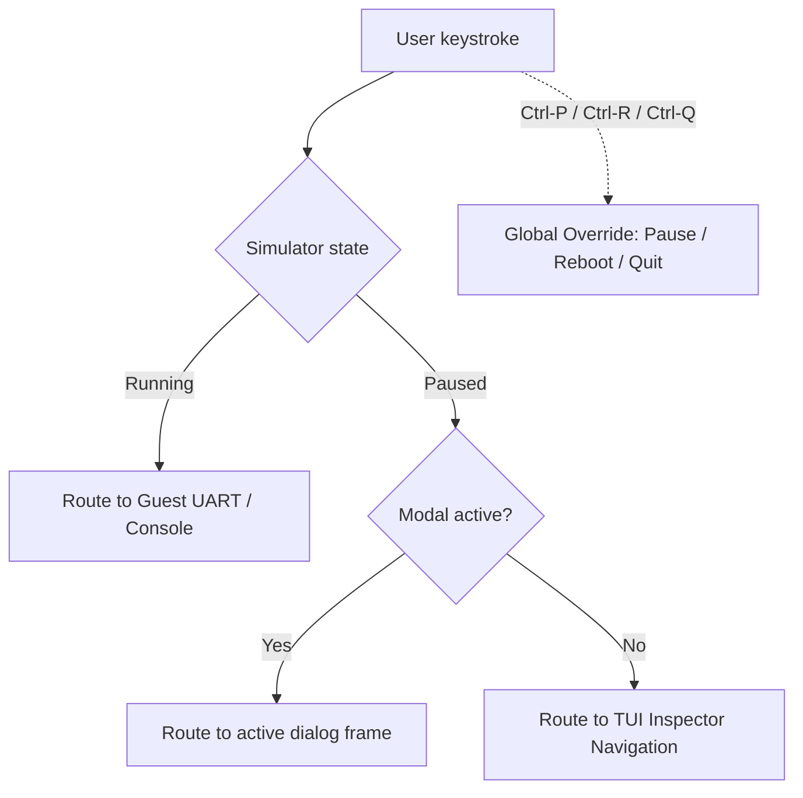

# Interactive TUI Workbench

SimRV features an interactive split-screen Terminal User Interface (TUI) workbench designed for computer architecture research, hardware verification, and education. It provides real-time visibility into register files, pipeline stages, memory hierarchies, and virtual peripherals alongside a live guest serial console.

---

## 1. Quick Start

The TUI is the default interface when running `simrv` without the `--cli` flag:

```bash
# Launch interactive TUI workbench with a guest binary
simrv -m examples/isa/bin/demo.elf

# Launch in cycle-accurate mode with a 5-stage pipeline
simrv --ca --pipeline 5stage -m examples/isa/bin/demo.elf

# Boot Linux interactively with graphical/serial console
simrv --os -m linux-images/rv64/alpine-gui/opensbi-linux-payload.elf \
      -D linux-images/rv64/alpine-gui/rootfs.img
```

---

## 2. Workbench Layout

The workbench layout dynamically adapts to your terminal dimensions (minimum 80×24, recommended 120×36 or larger):

```text
┌─ SimRV 3.0 ─────────────────────────────────────────── [Hart 0: RUNNING] ─┐
│ [Regs] [Pipeline] [Cache] [TLB] [Hazards] [Explainer] │ Guest Console PTY │
│                                                      │                    │
│ PC: 0x80000000   ra: 0x00000000   sp: 0x80010000     │ Linux version 7.2  │
│ IF: [0x80000020] addi a0, a0, 1                      │ simrv login:       │
│ ID: [0x8000001c] lw   a1, 0(sp)                      │                    │
│ EX: [0x80000018] mul  a2, a1, a0                     │                    │
│ MEM:[0x80000014] sw   s0, 4(sp)                      │                    │
│ WB: [0x80000010] addi sp, sp, -16                    │                    │
├──────────────────────────────────────────────────────┴────────────────────┤
│ [F1:Help] [F2:Load] [F5:Run] [F6:Step] [F8:Break] [Alt-M:MISA] [F10:Quit] │
└───────────────────────────────────────────────────────────────────────────┘
```

The interface is structured into three primary sections:

1. **Header & Status Bar**: Displays current hart ID, machine state (`RUNNING`, `PAUSED`, `STOPPED`), simulated clock cycles, retired instruction count, CPI/IPC, and simulation speed (MIPS).
2. **Left Subsystem Inspector**: Tabbed multi-view panel inspecting hardware state:
   - **`Regs`**: Live values of integer (`x0`–`x31`), floating-point (`f0`–`f31`), and vector registers (`v0`–`v31`).
   - **`Pipeline`**: In-flight pipeline slots across `IF`, `ID`, `EX`, `MEM`, and `WB` stages with data hazard stalls and branch mispredict bubbles.
   - **`Cache`**: Set-associative visualizer for L1 ICache, L1 DCache, L2, and L3 caches showing line tags, hit/miss rates, and MESI coherence states (`[M]`, `[E]`, `[S]`, `[I]`).
   - **`TLB`**: Page translation visualizer displaying virtual-to-physical address mappings, ASIDs, and page table walk states.
   - **`Hazards`**: Dependency hazard graph tracking RAW, WAR, and WAW scoreboard interlocks.
   - **`Explainer`**: Architectural decoder breaking down current instruction opcode, register operands, sign-extended split immediates, and privilege permissions.
   - **`Memory & Stack`**: Hex memory dump and stack frame unwind view.
3. **Right Guest Terminal**: Interactive virtual terminal connected directly to the guest platform's 16550A UART (`ttyS0`), VirtIO console, or Sixel graphical framebuffer.

---

## 3. Keyboard Navigation & Shortcuts

The TUI provides responsive hotkeys for simulation control and state inspection:

### Simulation Control

| Key | Action | Description |
| :--- | :--- | :--- |
| **`Ctrl-P`** / **`F5`** / **`c`** | Run / Pause | Toggle between continuous execution and paused inspection. |
| **`s`** / **`F6`** | Step Instruction | Execute exactly one instruction machine-wide across all harts. |
| **`c`** (in CA mode) | Step Cycle | Advance the pipeline and clock by exactly one hardware cycle. |
| **`Ctrl-R`** | Reboot | Reset architectural state, reload images, and restart simulation. |
| **`Ctrl-Q`** / **`F10`** / **`q`** | Quit | Exit SimRV cleanly and restore host terminal attributes. |

### Navigation & Focus

| Key | Action | Description |
| :--- | :--- | :--- |
| **`Tab`** / **`Shift-Tab`** | Change Focus | Cycle keyboard focus between the Inspector pane and Guest Console. |
| **`1`** – **`9`** | Switch Inspector View | Select Inspector sub-views (1: Regs, 2: Pipeline, 3: Cache, etc.). |
| **`Up`** / **`Down`** | Scroll | Scroll active panel line by line. |
| **`PageUp`** / **`PageDown`** | Page Scroll | Scroll active panel by page. |
| **`Home`** / **`End`** | Jump Boundary | Jump to the top or bottom of the active panel. |
| **`[`** / **`]`** | Resize Split | Adjust the relative width between inspector and console columns. |
| **`u`** / **`d`** | Scroll Logs | Scroll the bottom diagnostic message log window. |

### File & Search Operations

| Key | Action | Description |
| :--- | :--- | :--- |
| **`Ctrl-O`** / **`F2`** | Open / Load | Open the binary, disk, or CPU model file picker modal. |
| **`Ctrl-F`** / **`/`** | Search Console | Search UART terminal history (available when paused). |
| **`n`** / **`N`** | Next / Prev Match | Move to the next or previous search match in console scrollback. |
| **`Esc`** | Cancel / Close | Close active modal dialog or cancel active search query. |
| **`F1`** / **`?`** | Help & Glossary | Open keyboard shortcut reference or architectural glossary. |

---

## 4. Input Routing & Terminal Focus

To avoid dropping keystrokes or clashing between simulator commands and guest shell commands, SimRV enforces an intuitive, state-dependent input routing model:



- **Running State**: Keystrokes are delivered directly to the guest platform UART (`ttyS0`). Characters, arrow keys, and Control combinations (like `Ctrl-C`) go straight to the guest shell (e.g., BusyBox or Linux).
- **Paused State**: Keystrokes route to the TUI workbench controls for inspection, stepping, pane switching, and modal navigation.
- **Global Hotkeys**: `Ctrl-P` (pause/run), `Ctrl-R` (reboot), and `Ctrl-Q` (quit) always trigger simulator actions regardless of execution state.

!!! tip "Pause before inspecting or scrolling"
    To scroll through past console output or inspect registers, press `Ctrl-P` to pause execution. Once paused, `Tab` focuses the pane you wish to inspect. Press `Ctrl-P` again when ready to resume running.

---

## 5. Attachable TUI Sessions

SimRV supports detached headless simulation with on-demand interactive TUI attachment over local Unix domain sockets:

```bash
# 1. Start headless simulation server in the background
simrv --cli --listen-tui /tmp/simrv.sock -m examples/hello/build-rv64/hello.elf

# 2. Attach the interactive TUI workbench from another terminal
simrv --attach /tmp/simrv.sock

# 3. Stream plain screen snapshots to a file or pipe
simrv --cli --attach /tmp/simrv.sock > guest-screen.log
```

- Detaching does not interrupt guest execution; the guest continues at full hardware simulation speed.
- Re-attaching immediately resynchronizes live register, pipeline, and console state.
- The IPC protocol is framed, versioned, and validates payload bounds for safe local operation.

---

## 6. Classroom Mode & Student Guidance

When launched with `--class`, SimRV enables pedagogical student guidance features designed for computer architecture courses:

```bash
simrv --class -m examples/isa/bin/demo.elf
```

- **Interactive Guidance Pane**: When paused, the guide explains the currently selected inspector view and suggests a context-sensitive next exploration action. Press `Enter` to execute the suggested action.
- **Toggle Guide**: Press `g` to show or hide the guidance pane.
- **Architecture Glossary**: Press `?` to open the educational glossary jump-linked to the architectural concept represented by the active inspector view (e.g., pipeline hazard interlocks, cache associativity, or virtual memory translation).

---

## 7. Architecture & Customization (For Developers)

The TUI subsystem is modularly partitioned under `include/simrv/tui/`:

- **Framework Core (`tui/framework/`)**:
  - `Layout.hpp` & `Terminal.hpp`: Cell-based geometry calculations, box borders, clipping, and multi-column split sizing.
  - `Theme.hpp` & `Text.hpp`: Semantic ANSI palette mapping, word wrapping, padding, and cell-width measurement.
  - `ScrollView.hpp`: Reusable 2D viewports with boundary clamping and scroll indicator calculations.
  - `Modal.hpp` & `Components.hpp`: Reusable modal dialogue boxes, buttons, lists, and sliders.
- **Input & Terminal (`tui/TuiInputRouter.hpp`, `tui/VirtualTerminal.hpp`)**:
  - `TuiInputRouter.hpp`: State machine classifying input bytes based on modal, pause, and focus state.
  - `VirtualTerminal.hpp`: ANSI/VT100 escape parser maintaining guest screen buffers and history.
- **Panels & Telemetry (`tui/panels/`)**:
  - Specialized view renderers (`InspectorPaneRegs.cpp`, `InspectorPanePipeline.cpp`, `InspectorPaneCache.cpp`, `InspectorPaneTlb.cpp`, `InspectorPaneHazard.cpp`).
